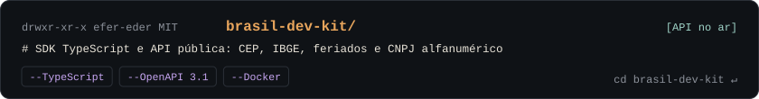
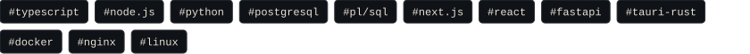

```text
construo software para resolver problemas reais.
APIs, ferramentas open source e experimentos com IA.
da ideia ao deploy, gosto de fazer acontecer.
```

### ~/open-source

<a href="https://github.com/Efer-Eder/brasil-dev-kit"></a>
<a href="https://github.com/Efer-Eder/brasil-tax-playground"></a>
<a href="https://github.com/Efer-Eder/agent-orchestra"></a>

### rodando de verdade

<p>
<a href="https://github.com/Efer-Eder/brasil-dev-kit"></a>
<a href="https://github.com/Efer-Eder/brasil-tax-playground"></a>
</p>

### stack



<sub>I build software to solve real problems: APIs, open source tools and AI experiments, from idea to deploy.</sub>

`efer.online` &middot; [site](https://efer.online) &middot; [linkedin](https://www.linkedin.com/in/efer-eder)
