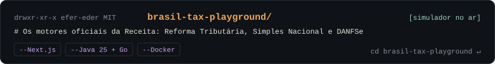
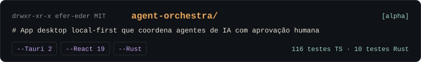

```text
construo software para resolver problemas reais.
APIs, ferramentas open source e experimentos com IA.
da ideia ao deploy, gosto de fazer acontecer.
```

### ~/open-source

<a href="https://github.com/Efer-Eder/brasil-dev-kit"></a>
<a href="https://github.com/Efer-Eder/brasil-tax-playground"></a>
<a href="https://github.com/Efer-Eder/agent-orchestra"></a>

### ~/currently-building

```text
atualizado em 2026-11

brasil-dev-kit          publicar a 0.1.0 no npm
brasil-tax-playground   paridade na CI e emissor didático de NFS-e
agent-orchestra         testar com provedor real e publicar o instalador
```

### rodando de verdade

**Brasil Dev Kit**: CEP, feriados e CNPJ direto do terminal.

<p align="center"><a href="https://github.com/Efer-Eder/brasil-dev-kit"></a></p>

**Brasil Tax Playground**: a API chamando o motor oficial da Receita.

<p align="center"><a href="https://github.com/Efer-Eder/brasil-tax-playground"></a></p>

**Agent Orchestra**: o app desktop com plano, aprovação, diff e revisão.

<p align="center"><a href="https://github.com/Efer-Eder/agent-orchestra"></a></p>

### stack


[efer.online](https://efer.online) &middot; [LinkedIn](https://www.linkedin.com/in/efer-eder)
